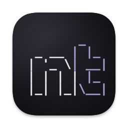

<p align="center">
  
</p>

<h1 align="center">NanoTeams</h1>

<p align="center">
  <b>Free, open-source AI coding agent &amp; multi-agent teams for macOS<br>— 100% local via Ollama or LM Studio, with an autonomous supervisor</b>
</p>

<p align="center">
  <a href="https://github.com/jmstajim/NanoTeams/releases/latest"></a>
  <a href="https://github.com/jmstajim/NanoTeams/releases"></a>
  
  <a href="https://github.com/jmstajim/NanoTeams/blob/main/LICENSE"></a>
</p>

<p align="center">
  <a href="https://github.com/jmstajim/NanoTeams/releases/latest/download/NanoTeams.app.zip"></a>
</p>

<p align="center">
  
</p>

**NanoTeams is a free, open-source, local-first AI coding agent and multi-agent AI team app for macOS.** It runs 100% on-device through [Ollama](https://ollama.com) or [LM Studio](https://lmstudio.ai) — no cloud, no API keys, no subscription, no telemetry — so the local models you already run can read and edit your files, run git and Xcode, control the screen, and coordinate specialized AI roles inside a sandboxed work folder.

Chat with the **Coding Assistant** to read and edit your files, or let the **Coding Agent** make small changes itself and hand the heavy lifting to a full team of AI roles that plan, build, review, and ship. It's universal, too: because a team is just AI roles you configure, the same engine drafts documents, plans projects, or runs research. Flip on the **Autovisor** and it runs the whole folder on its own. NanoTeams also speaks **MCP** both ways, in beta: your roles can use tools from MCP servers you connect, and a coding agent such as Claude Code can hand work to your local team. Your code and your ideas stay on your machine unless you connect one of those outside servers or agents yourself.

*Built for Mac developers who run local models in Ollama or LM Studio and anyone whose code can't leave the machine — privacy-first, NDA, or air-gapped work.*

**[Download for macOS](https://github.com/jmstajim/NanoTeams/releases/latest/download/NanoTeams.app.zip)** · free & open-source (MIT) · [Get started](#getting-started) · [All releases](https://github.com/jmstajim/NanoTeams/releases)

## Why NanoTeams?

The goal is simple: make local LLMs work as fast and efficiently as possible in real tasks — writing code, making decisions, organizing your thinking, drafting documents, and bringing ideas to life.

**NanoTeams** treats smaller models as the design constraint.

Every request is shaped so your server can reuse the prompt it already processed, which is what keeps responses fast. The architecture forgives mistakes. Every piece of the program compensates for something local models don't do well.

It's a native Mac app — pure Swift/SwiftUI, with zero third-party dependencies: nothing in the supply chain but Apple's own frameworks.

## Getting Started

> Requires **macOS 15.0+** and either **[Ollama 0.9+](https://ollama.com)** or **[LM Studio 0.4.0+](https://lmstudio.ai)**

1. **[Download NanoTeams.app.zip](https://github.com/jmstajim/NanoTeams/releases/latest/download/NanoTeams.app.zip)** ([all releases](https://github.com/jmstajim/NanoTeams/releases)), extract it, and drag `NanoTeams.app` into Applications.
2. **First launch:** macOS will warn that it "can't verify" the app, because it isn't notarized yet. Open **System Settings → Privacy & Security → Open Anyway**.
3. Start **Ollama** or **LM Studio** and load a model that fits your Mac (see [My Current Stack](#my-current-stack) for what I run).
4. Launch **NanoTeams**, pick your provider in **Settings → LLM**, and select a work folder (where AI roles read and write files).
5. Pick a team. **Coding Assistant** is the default (chat-mode with files, git, and Xcode tools); **Coding Agent** edits small changes itself and delegates bigger work to another team.
6. Create a task, describe what you need, and the team takes it from there.


## How does NanoTeams work?

You are the **Supervisor**. You create a task, and a team of AI roles executes it step by step based on artifact dependencies.

Take the **FAANG Team**: you describe what you want → PM writes requirements → UX researches and designs → Tech Lead plans → Engineer implements → Code Reviewer checks the code → SRE verifies production readiness → TPM writes release notes → you review and accept.

Each role can read/write files, use git, build with Xcode, consult other roles, request team meetings, and delegate a self-contained sub-task to another team, all inside a sandbox limited to your work folder.


## Features

Everything below runs on your Mac against your own local model in **Ollama** or **LM Studio**, except what reaches an MCP tool server or an outside agent you connect (see [Privacy & Security](#privacy--security)). Pick either provider in **Settings → LLM**, or mix them — individual roles, Vision, the built-in Autovisor, and the MCP Auto judge can each point at their own server.

### Multi-Agent AI Teams
Turn one task into a coordinated team effort. Each role has its own instructions, tools, and deliverables, and they collaborate through quick consultations, group meetings, and change requests.

### Autovisor: Automated Supervisor
Let an autonomous agent run the folder while you do something else — driven either by a **built-in local model** or by an **external coding agent** over MCP. With the **Built-in Model** driver, give the **Autovisor** a goal and it watches your tasks, creates and schedules new ones, answers the questions roles would normally ask you, reviews finished work, and closes it, remembering what it learned along the way; it wakes when a task needs attention, idles when there's nothing to do, and a sleep timer (3 hours by default, adjustable in Settings) stops it so it can't run all night. Switch the driver to **External Agent (MCP)** and your own coding agent supervises the tasks it creates instead; see [External Agents](#external-agents-claude-code-codex-or-cursor-as-the-supervisor-beta).

### External Agents: Claude Code, Codex, or Cursor as the Supervisor (Beta)
Hand work from the coding agent you already use to your local team. The agent writes the brief and supervises; your local models do the work in the team roles.

- **Connect.** In **Settings → External Agents**, turn on NanoTeams's own MCP server. It listens on this Mac only (`127.0.0.1:47321` and `[::1]:47321`; the port is adjustable). Add an agent, and it gets its own token; NanoTeams keeps only a SHA-256 hash of it in the Keychain and writes the token into a private file that the built-in `--mcp-stdio` bridge reads, so a client that speaks stdio (Claude Code, Claude Desktop, Codex, Cursor, VS Code, Gemini CLI and others) holds no secret in its configuration; a client that sends the token in a header copies it once. Each agent's sheet (after **Add agent**, or from **How to connect** on its row) gives a setup prompt for any assistant first; under **Set it up by hand** it lists the connection facts with Copy buttons — bridge command, bridge arguments (with the token file), address, and call timeout. The client's own configuration format is yours, or your assistant's, to write.
- **Or let an assistant set it up.** **Copy prompt** gives you one text to paste into any assistant. It carries the connection facts (address, header, bridge command and arguments, token file, call timeout) and the rules for where a token may live, asks the assistant to work out which client you use and to write that client's configuration from the facts, and walks you through the setup. The prompt never contains your token.
- **Turn on the Autovisor.** Set its driver to **External Agent (MCP)** and switch it on. The agent then gets 16 tools. It can read the folder's status and teams, and create tasks on the teams you allow or on a team generated on the fly. For its own tasks, it can answer role questions, accept work or request changes, restart roles, and message, schedule, pause, or close the task. It can wait up to an hour per call for events, read its tasks' deliverables and transcripts, and read `task_changes`: the diffs of everything changed in the work folder while a pass of one of its tasks ran — your edits and other tasks' included. NanoTeams gives it your Autovisor goal as standing direction and your memory as notes; it can read both and change neither. If you allow it with the switch on its row, which stays off until you turn it on, it can also replace the folder's Work Folder Context. Roles of your own tasks read that text too, on every team whose prompt includes it, and NanoTeams keeps no earlier version of it to restore.
- **You stay in charge.** The agent changes only the tasks it created, plus the Work Folder Context if you allowed it; tasks you create stay yours, approval cards included. No approval card appears for its own tasks, so tools that would need you are withheld or refused there unless Auto mode hands the call to the LLM judge. By default, it can't create a task while 2 of its tasks are running, can't hold more than 3 open, and can't create more than 5 in any 15 minutes; change these in **Settings → Autovisor → Limits**. Answer its questions or close its tasks yourself, turn the Autovisor off to refuse every change at once, or revoke its token. The sleep timer counts from its last request, and the agent's calls never open or bring forward a NanoTeams window (the `--mcp-stdio` bridge starts a closed NanoTeams in the background).
- **Watch its calls.** The **External Autovisor** pane lists the agent's last 200 calls. Tap one to see the arguments as NanoTeams read them and the exact response the agent got, uncut. Filter the list by task, or hide what's there so far; hiding it also hides Recent Activity on the main screen, and nothing is deleted.

Tested live with Claude Code using a hand-written configuration. The connection facts in the agent's sheet, the setup prompt, the bridge's background launch of a closed NanoTeams, and Codex, Cursor, VS Code, Gemini CLI, and Claude Desktop have not been tested yet, and no client has replaced the Work Folder Context live yet. Your first visit to External Agents shows its risks and an as-is disclaimer to accept before you start, and [Privacy & Security](#privacy--security) lists what the agent can read and change.

### Team Delegation
A role can hand a bigger, self-contained job to another team and get the finished work back. The built-in **Coding Agent** does exactly this: it makes small edits itself and passes larger, multi-file work to the **Engineering Team**, **Startup**, or a team generated on the fly. While the other team works, you can step in through the delegating role to pause it, redirect it, or cancel. Turn it on per role and pick which teams that role may hand work to.

### Shell Commands (Bash)
Code-writing roles can run real terminal commands, including long-running ones you watch as they go. It's **manual by default**: every command waits for your one-tap **Allow** or **Deny**, and an **Ask AI** button explains in plain language what a command does and whether it's safe before you decide. Want less friction? Let trusted commands run on their own, or hand approval to an LLM judge. Either way, every command runs in a macOS sandbox that keeps changes inside your work folder and away from your credentials. On for code-writing roles and for every Ultra Team role; other read-only roles stay command-free.

### Computer Use (Screen Control)
Some jobs need the screen, not just files. A role can take a screenshot and then click, type, and scroll in other Mac apps to get them done. It's **manual by default**: you approve every click, keystroke, and key press with a preview of its target, and the first screenshot of a run; scrolling and later screenshots run on their own. Prefer hands-off? Hand approval to an LLM judge at the strictness you choose, or turn the feature off entirely. Built-in guardrails keep it from ever touching NanoTeams itself, an optional app allowlist limits which other apps it may control, and macOS asks for screen and accessibility permission the first time.

### MCP Tool Servers (Beta)
Give your roles tools, read-only resources, and prompts from MCP servers you connect. Add a server in **Settings → MCP Servers** over Streamable HTTP: `https`, or plain `http` for a server on this Mac. Authentication is a bearer token, secret headers such as an API key, both, or none, with every secret kept in the Keychain; OAuth and local stdio servers aren't supported. Servers come only from Settings: opening a work folder never reads its `.mcp.json`.

- **Review before use.** Every tool, resource, and prompt a server lists waits for your approval, and the review shows the full text the server publishes for it. NanoTeams pins each by a SHA-256 hash of its name, title, description, schemas, and annotations. If the server rewrites any of that, the item comes back as **Changed** with a −/+ diff, loses its Always allow, and stays out of every prompt until you approve it again. What a call returns, a resource's contents, and the text a picked prompt expands to come live from the server and aren't part of that review.
- **Grant per role.** Give a role single tools or a whole server in the Role Editor's Tools tab, or switch a server off for one work folder. Approved prompts appear in the `/` picker (prompts that take arguments aren't supported yet). Team meetings never get MCP tools.
- **Approve calls your way.** **Manual** (the default): every call waits on a card that shows its exact arguments, with **Ask AI** for a second opinion. **Semi-automatic**: mark tools Always allow, or let a server you trust run the tools it marks read-only. **Auto**: whatever those rules don't clear goes to a one-shot LLM judge at the strictness you set per server, and the judge never sees the conversation. A call to a second server in the same step is never pre-approved: it goes to you, or in Auto to the judge. When nobody can approve, as on an autonomous team or a task the Autovisor supervises, tools that would need a person are withheld.

Like External Agents, **Settings → MCP Servers** first shows its risks and an as-is disclaimer, which you accept once.

### Model Benchmark
Which of your local models is actually fastest on *your* Mac? **Settings → Support → Benchmark** measures it. Run one model, or tick **All models** and let it sweep every model on both Ollama and LM Studio unattended. For each run you get **generation speed** (tok/s), **time to first token**, **prompt prefill** speed, and — where the server separates them — the share of output that was thinking. Every figure is a **median** over several samples, so one thermally unlucky run can't flatter a model, and anything the server didn't report is marked `~` or left blank rather than guessed.

Results build a **leaderboard** ranked by median speed, with each model's single fastest **sample** beside it — and the size of the set it won, because a maximum over more draws is expected to be higher. There's a full run history too: every sample, the ones that were thrown out and why, thermal state, VRAM, engine build, and the exact request body. It's kept outside your work folder — generation speed is a fact about the machine, not the project.

Two things worth knowing before you start a sweep. It **unloads your models** — both providers draw on the same memory, so everything is cleared, then each model is loaded, warmed up, and sampled alone; switch a server off to leave it untouched. And it takes **several minutes per model** — every answer is measured to its end, because cutting one off measures the cut rather than the model, so a verbose model costs more (five samples of a 27B reasoning model took about 4.7 minutes). The workload is one fixed prompt (~2,480 tokens in) with a fresh nonce each time so nothing is served from the server's prompt cache; a runaway answer is capped at 8,192 tokens and then discarded rather than ranked. Benchmarks never run while a task is running, and never switch your app onto the model being measured.

### Privacy & Security
**NanoTeams** never sends your code, files, or prompts off your Mac unless you connect an external MCP tool server or turn on **External Agents**. By default, its only outbound call is a once-a-day check for a new version — configurable, and you can turn it off entirely. Everything else runs on-device through Ollama or LM Studio, with no telemetry and no account.

**MCP tool servers.** Connecting a server sends it a handshake and requests for its tool, resource, and prompt lists, with any token or headers you set; NanoTeams reconnects on its own and re-reads those lists when they change. A call reaches the server only after approval: from you, from an Always allow or Trusted read-only rule you set, or in Auto mode from the LLM judge. Prompts you pick from the `/` picker are fetched from it, too.

**External Agents.** While External Agents is on, an agent holding one of its tokens can read the following in whichever work folder is open, whether or not that folder's Autovisor is on:
- every top-level task, yours included: title, status, who created it, the full text of waiting questions, last error, artifact paths, per-role progress, run timing, schedule, and why it paused;
- the folder's path and name, the Autovisor's goal and memory, your Work Folder Context with the names (not the contents) of the instruction files your roles read, the Xcode scheme, and the sleep-timer deadline;
- your main model, its provider, and whether it answers, plus the teams the agent may use, with their descriptions, roles, and each role's model;
- your MCP tool servers' names, status, approval modes, Trusted marks, and approved tool names, and your bash and computer-use approval modes.

An agent you allow can also replace your Work Folder Context, which the roles of your own tasks read too, on every team whose prompt includes it.

For the tasks it creates, it gets the latest run in full: deliverables and other artifacts, role replies and questions, the transcript (including what you type into those tasks, with each tool call as a one-line summary), and the list of files the team wrote, so whatever those roles read in your folder can reach it. Through `task_changes` it reads complete unified diffs — the full changed contents of each text file — of every file changed in the work folder while a pass of one of its tasks ran, whoever changed it: the team, another task, you, or another program. The snapshots behind them live in a private Git store at `.nanoteams/internal/snapshots.git` (owner-only permissions, ignored by git and Spotlight) and are kept as long as the task exists, with no size limit; deleting the task deletes them. NanoTeams' own `.nanoteams` folder (task artifacts and attachments included), files your git ignore rules hide, embedded repositories, and the other places NanoTeams hides from a team's tools are not snapshotted; a binary file is listed as changed without its contents. If the agent uses a cloud model, it may send any of this to its cloud provider.

File access is sandboxed to your work folder, the terminal, screen-control, and MCP tools ask before they act by default, and a macOS Seatbelt sandbox keeps `bash` changes inside your folder and away from your credentials, the port external agents connect to, and agent tokens (note that `run_xcodebuild` and `run_xcodetests` run outside Seatbelt as required by the developer toolchain, so they can reach the External Agents server like any program you run; the git tools also run outside it, with the repository's hooks, `core.fsmonitor`, submodule recursion, external diff drivers and textconv filters switched off).

### More features

| Feature | What it does |
|---------|--------------|
| **AI Team Generation** | Describe a task in one line; a local LLM designs a custom team — roles, prompts, and how they hand work off. |
| **Global Context** | One shared instruction box every role in every team follows — house rules, coding standards, tone. |
| **Agent Instructions (CLAUDE.md & co.)** | Auto-picks up `CLAUDE.md`, `AGENTS.md`, `GEMINI.md`, `.cursorrules`, Copilot and Windsurf rules from your repo. |
| **Agent Skills ("/" Picker)** | Tap `/` in any message box to pull in skills and slash-commands from Claude Code, Codex, Cursor, Gemini CLI, GitHub Copilot, Windsurf, and OpenCode, plus approved prompts from connected MCP servers. |
| **✦ Improve Prompt** | One tap rewrites a rough draft into a cleaner prompt with your local model, Apple Writing Tools style — undo brings the original back. |
| **51 Built-in Tools** | Files, terminal, git, Xcode build/test, team collaboration and delegation, team generation, artifacts, image analysis, and screen control. |
| **MCP Tool Servers** | Beta. Tools, read-only resources, and prompts from HTTP MCP servers you add in Settings → MCP Servers, each pinned by SHA-256 and approved in Manual, Semi-automatic, or Auto (LLM judge) mode. [Details](#mcp-tool-servers-beta) |
| **External Agents (Hosted MCP & `--mcp-stdio`)** | Beta. Claude Code, Codex, Cursor, VS Code, Gemini CLI, or Claude Desktop creates and supervises tasks through NanoTeams's local MCP server or `--mcp-stdio` bridge while your local models run the team roles. Tested with Claude Code (hand-written configuration); the connection facts and the other clients are untested. [Details](#external-agents-claude-code-codex-or-cursor-as-the-supervisor-beta) |
| **Documents In & Out** | Reads PDF, DOCX, RTF, XLSX, PPTX, and ODT directly (no manual conversion); exports artifacts to PDF, Word, or RTF. |
| **Universal Search** | Keyword search across PDFs, Office docs, slides, OpenDocument, HTML, source code, and plain text — one tool call. |
| **Exploratory Search (Semantic)** | Search your project by meaning, not just keywords — runs entirely on-device; opt-in in Settings. |
| **Per-Role LLM Configuration** | Give each role its own local model, server, and provider — a fast small one for planning, a heavyweight coder for the hard parts. |
| **Native Tool Calling** | On Auto, NanoTeams asks Ollama or LM Studio whether the selected model was trained for tool use and, if it was, sends the tools on the provider's own `tools` field; otherwise it teaches the call format in the prompt. Settings → LLM can force either mode. |
| **Vision (Image Analysis)** | Point a separate image-capable model at screenshots, diagrams, and photos; leave its fields empty to fall back to your main model. |
| **Quick Capture** | Two global hotkeys create tasks, answer AI questions, or attach a selection from any app; paste files, screenshots, or text with ⌘V. |
| **Private Voice Dictation** | On-device, multilingual, offline dictation wherever you write (requires macOS 26+). |
| **Team Meetings & Change Requests** | Roles consult, hold group meetings with voting, and request changes that redo work with full context. |
| **Supervisor Questionnaire** | When a role needs several answers at once it asks with a form instead of prose — each question with the answers it thinks likely, a recommendation it can state, and a free-text escape. Leave one alone and it comes back unanswered, and the role is told to decide it itself and record the assumption. |
| **Automatic Context Compaction** | A long-running role would walk into its context window and be silently truncated. NanoTeams watches the server's own prompt counter and, at the threshold, replaces the conversation with its exact opening plus a summary that keeps every Supervisor turn verbatim. The chip beside the role shows how full it is; clicking it compacts on demand. |
| **Supervisor Message Queue** | Nudge a working role (or the whole team) without stopping it; a message also resumes a paused or failed run where it left off. |
| **Scheduled & Recurring Tasks** | Run any task on a schedule — interval, daily, monthly, or once; a timeout auto-pauses a run that overruns. |
| **Artifact Dependency Pipeline** | Roles pass named deliverables; NanoTeams works out the running order and shows it as a live team graph. |
| **Custom Teams** | Build your own teams — roles, deliverables, prompts, and wiring — and import/export them as JSON. |
| **Model Benchmark** | Measure generation speed, time-to-first-token and prompt prefill for any local model, or sweep every model on both providers unattended; results build a leaderboard with full run history. |
| **Themes** | Multiple built-in color themes (see below). |


**[Download NanoTeams](https://github.com/jmstajim/NanoTeams/releases/latest/download/NanoTeams.app.zip)** — free, about two minutes to your first running team.

## Built-in Teams

Start with a ready-made team, then customize it or generate your own.

| Team | Description |
|------|-------------|
| **Coding Assistant** *(default)* | Dialog-first coding companion with files, git, and Xcode tools |
| **Coding Agent** | Hybrid coding agent: edits files itself for small changes, delegates complex implementation to a chosen team |
| **Personal Assistant** | Conversational AI helper for any task |
| **FAANG Team** | Full product pipeline: PM → UX → Engineering → Code Review → SRE → Release |
| **Engineering Team** | Lean pipeline: Tech Lead → Engineer → Code Review → Release |
| **Ultra Team** | Change pipeline on any stack: a brief and its critique, two competing designs, two adversarial critiques, one writer, diff review, and a verified build |
| **Startup** | One engineer you direct, minimal process, fast iteration |
| **Quest Party** | Four specialists build a fantasy world, then the Quest Master runs an interactive adventure where you are the hero |
| **Discussion Club** | Five distinct personalities debate any topic in a lively multi-agent discussion |

## How do roles work?

Every role in a team is one of three types. The type sets what the role does and how it finishes.

### Producing Roles
Most roles are producing: they create specific deliverables called artifacts. A PM produces "Product Requirements," an Engineer produces "Engineering Notes," a Code Reviewer produces "Code Review Summary."

You don't need to do anything. The role reads files, uses tools, and consults teammates on its own, then finishes once it has submitted all its artifacts. You watch the activity feed and review the results.

All roles in the FAANG, Engineering, Ultra, and Startup teams are producing roles.

### Chat Roles
Some roles don't produce artifacts. Instead, they talk to you. After reading upstream artifacts (or only your task description), the role enters an open-ended conversation loop, asking you questions and responding to your answers.

The role never finishes on its own. It keeps the conversation going until you pause or close the task. This is how the Personal Assistant works: pure back-and-forth dialogue. In the Quest Party, the Quest Master reads all the world-building artifacts from other roles, then runs an interactive adventure where you play the hero.

When a team has no required deliverables for the Supervisor, the UI switches to Chat mode, and you'll see a "Chat" label instead of "Working" or "Review."

### Observer Roles
A few roles have no artifacts at all: they don't produce anything and don't depend on anything. They sit in the team graph but don't run on their own. Instead, they come alive when invited to team meetings, contributing their perspective to group discussions.

In the Discussion Club, four personality roles (The Open, The Conscientious, The Extrovert, The Neurotic) are observers; only The Agreeable runs as a producing role, kicking off meetings where all five debate the topic together.

## My Current Stack

My favorite stack right now is **[LM Studio](https://lmstudio.ai)** with the **[Splash](https://github.com/incoai/splash)** engine, running Inco AI's Splash builds of two Qwen models:

| Model | Hugging Face | LM Studio shows |
|-------|--------------|-----------------|
| **qwen3.6-35b-a3b-splash** | [incoai/Qwen3.6-35B-A3B-Splash](https://huggingface.co/incoai/Qwen3.6-35B-A3B-Splash) | Vision · Tool use · Reasoning |
| **qwen3.8-27b-splash** | [incoai/Qwen3.8-27B-Splash](https://huggingface.co/incoai/Qwen3.8-27B-Splash) | Vision · Tool use · Reasoning |

Splash is Inco AI's open-source inference engine for Apple silicon, and each of these models ships with its own draft model for speculative decoding. It needs an M3 or newer Mac on macOS 26.4 or later with at least 36 GB of unified memory (Inco recommends 48 GB or more). In LM Studio, it installs as **Splash (Metal)** under **Settings → Runtime → Experimental backends**. LM Studio's [Splash setup guide](https://lmstudio.ai/blog/splash-engine) covers the engine and the models; it's written for LM Studio's separate Bionic app, and the regular LM Studio app that NanoTeams connects to offers the same backend.

NanoTeams works with any model you can run in Ollama or LM Studio, so on a Mac that can't run Splash, pick what fits and let [Model Benchmark](#model-benchmark) tell you which is fastest. Have a favorite local LLM? [Open an issue](https://github.com/jmstajim/NanoTeams/issues) and I'd love to make **NanoTeams** work better with it.

## Build from Source

```bash
git clone https://github.com/jmstajim/NanoTeams.git
cd NanoTeams
xcodebuild -project NanoTeams.xcodeproj -scheme NanoTeams -configuration Release build
```

No external dependencies — nothing in the supply chain but Apple frameworks. Pure Swift/SwiftUI.

## FAQ

### Is NanoTeams a local, offline alternative to Cursor, Claude Code, Codex, or GitHub Copilot?
Yes. NanoTeams is an on-device AI coding agent for macOS: it runs entirely through a local model in Ollama or LM Studio, so your code never leaves your Mac unless you explicitly connect an external MCP tool server or turn on External Agents ([Privacy & Security](#privacy--security) lists what each one gets), and you need no account, no API key, and no subscription. Unlike cloud assistants such as Cursor, Claude Code, Codex, and GitHub Copilot, it keeps working offline after the first download — useful for privacy-first, NDA, or air-gapped work. It can also work alongside them: through External Agents (beta), a coding agent such as Claude Code can hand tasks to your local team. It's a native Mac app, not a CLI or a VS Code extension.

### Is NanoTeams free?
Yes. **NanoTeams** is open-source and free. There are no subscriptions, no API keys, and no usage limits. You only pay for the hardware your local LLM runs on.

### Does NanoTeams send my data anywhere?
No, unless you connect an external MCP tool server or turn on **External Agents**. All role inference runs through Ollama or LM Studio on your Mac; by default, your files, prompts, and built-in tool calls never leave your machine, and the app's only outbound call is a once-a-day version check (configurable, and you can turn it off entirely). An MCP tool server gets the handshake, its list requests, and the calls that are approved. While **External Agents** is on, an agent holding one of its tokens gets the results and transcripts of the tasks it creates. In whichever folder is open, it can also read every top-level task's title, status, questions, errors, and schedule (yours included), the Autovisor's goal and memory, your Work Folder Context, the teams it may use and their models, and your approval settings, and it may send any of this to its cloud provider. [Privacy & Security](#privacy--security) has the full list. No telemetry, no account.

### Do I need an internet connection?
No, after the initial download of Ollama or LM Studio and a model. **NanoTeams** works offline, which helps for travel, secure environments, or air-gapped machines. An MCP tool server you reach over the network still needs that network.

### Can NanoTeams run autonomously?
Yes. Turn on the **Autovisor** — an automated Supervisor — and NanoTeams runs the work folder on its own, driven either by a built-in local model (which creates and schedules tasks, answers role questions, reviews finished work, closes it, remembers what it learned, and stops on a 3-hour adjustable sleep timer) or, in beta, by an external coding agent that connects through External Agents (the local Hosted MCP server or `--mcp-stdio` bridge) and supervises only the tasks it creates; one you allow can also replace the folder's Work Folder Context. Message the built-in Autovisor any time to steer it.

### Can Claude Code, Codex, or Cursor hand work to local models?
Yes, through **External Agents** (beta). NanoTeams runs a local MCP server on your Mac: turn it on and add an agent in **Settings → External Agents**, set the Autovisor driver to **External Agent (MCP)** and switch the Autovisor on, and your coding agent can create tasks on your teams, answer their questions, review the results, and close them while your local models do the work in the roles. Each agent's sheet in **Settings → External Agents** gives a setup prompt for any assistant and, under **Set it up by hand**, the connection facts (bridge command and arguments, address, call timeout) with Copy buttons; you write the client's own configuration from them. It has been tested live with Claude Code using a hand-written configuration; the facts, the prompt and the other clients haven't been tested yet.

### Does NanoTeams support MCP?
Yes, in both directions, and both are in beta. As a client, it connects to MCP servers over Streamable HTTP for tools, read-only resources, and prompts, pins every item by SHA-256, and runs a call only once you, a rule you set, or an LLM judge approves it. As a server, it lets an external coding agent drive tasks through **External Agents**. OAuth and local stdio servers aren't supported on the client side.

### What are multi-agent teams, and how many are built in?
A team is a group of AI roles — each with its own instructions, tools, and deliverables — that collaborate through consultations, group meetings, and change requests. NanoTeams ships with 9 built-in teams (Coding Assistant, Coding Agent, Personal Assistant, FAANG, Engineering, Ultra Team, Startup, Quest Party, Discussion Club) and 3 role types (producing, chat, observer). You can also describe a task in one line and have a local LLM generate a custom team for it.

### What models does NanoTeams support?
Any model you can run in Ollama or LM Studio. My favorite stack right now is LM Studio with the Splash engine running `qwen3.6-35b-a3b-splash` and `qwen3.8-27b-splash`; see [My Current Stack](#my-current-stack). For image analysis, you set one vision model in **Settings → Vision** — it overrides your main model for `analyze_image`, and if you leave its fields empty it falls back to your main LLM. Per role, you can override the main text model, its server, and its provider. Sampling settings stay with the server, so the per-model config you already keep in a modelfile or in LM Studio is what runs. One exception to the provider choice: Exploratory Search embeddings need LM Studio.

### Why use NanoTeams instead of a hosted AI assistant?
Hosted assistants run massive frontier models in the cloud and are excellent at what they do. **NanoTeams** is a different choice for a different need: when your code or data can't leave the machine, when you don't want a subscription or per-token bill, or when you want a multi-agent workflow with specialized roles, artifact pipelines, and on-device embeddings around whichever local model you prefer.

### What are the system requirements?
macOS 15.0 or later. Ollama 0.9 or later, or LM Studio 0.4.0 or later. Apple Silicon recommended for best local-LLM performance. Voice dictation requires macOS 26+.

## Support

For questions, issues, or feature requests, [open an issue](https://github.com/jmstajim/NanoTeams/issues) or reach out via [email](mailto:gusachenkoalexius@gmail.com) · [LinkedIn](https://www.linkedin.com/in/jmstajim/).

---

**If NanoTeams is useful, [⭐ star the repo](https://github.com/jmstajim/NanoTeams)** — stars are how other local-LLM developers find it. Want release notifications without the noise? **Watch → Custom → Releases**.

**[Download for macOS](https://github.com/jmstajim/NanoTeams/releases/latest/download/NanoTeams.app.zip)** · [Get started](#getting-started) · [All releases](https://github.com/jmstajim/NanoTeams/releases)
